# ReapSeek

A multi-seller marketplace in the style of large e-commerce sites: a canonical product catalog with variants and competing seller offers, search with facets, cart and checkout, orders split into per-seller packages, payments, shipping, returns, reviews and a seller back office.

ReapSeek is the flagship customer of [ReapDeep](https://github.com/guvenimat/ReapDeep), a multi-tenant product analytics platform. It uses ReapDeep only through its public interfaces, exactly as any other customer would:

- the ReapDeep JS SDK for page views, product views, cart and search events;
- server-side `purchase` and `refund` events from the order pipeline;
- the catalog API to keep ReapDeep's product catalog in sync;
- the ReapDeep Recommender for "similar items", "frequently bought together", popular and trending lists;
- RFM segments and cohorts for coupon targeting and email campaigns;
- ReapDeep alerts, delivered to ReapSeek as signed webhooks.

> Status: accounts, the marketplace catalog (sellers, products, variants, offers, buy box), the back office, search with faceted category pages, product pages, the cart, checkout with card payments and 3-D Secure, orders split into seller packages, and the ReapDeep integration (catalog sync, behavioral events, identity, purchases) are in place. Recommendations, the seller panel, after-sales and marketing follow in stages.

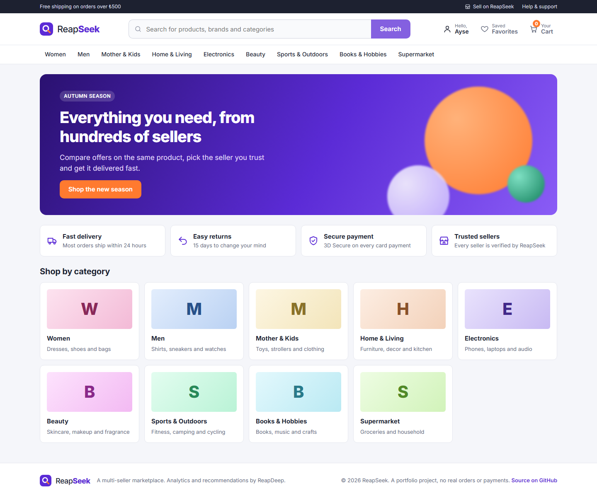

## Architecture

| Component | Technology |
|---|---|
| Storefront | Next.js (server-side rendering), TypeScript |
| Back office (admin and sellers) | React, Vite, TypeScript |
| API | .NET 10 Minimal API, Native AOT, modular monolith |
| Background jobs | .NET 10 worker with a transactional outbox |
| Database | PostgreSQL, versioned SQL migrations |
| Search | OpenSearch |
| Cache and shared limits | Redis (StackExchange.Redis) |
| Payments | `ReapSeek.Sandbox`, a simulated payment provider with hosted payment pages and signed webhooks |
| Email | Mailpit (local) |
| Analytics and recommendations | ReapDeep |

### Code architecture

The backend is a **modular monolith**: one API (stateless, so it can run as several instances behind a load balancer) and one worker, with code organized by feature (`Catalog/`, `Search/`, `Carts/`, `Checkout/`, `Orders/`, `Payments/`, ...) rather than by technical layer. Each feature keeps the same three kinds of classes: `*Endpoints` (routes and access rules, no SQL), a service or pure logic class, and a repository (Dapper with compile-time generated mapping, so everything runs under Native AOT). The architecture is not uniform on purpose; each area uses the simplest style that carries its rules:

| Area | Style | Why |
|---|---|---|
| Catalog, search, accounts, back office reads | Feature folders, services and SQL read models | Mostly CRUD and queries. The rules (buy box, listing visibility) are best expressed in SQL, close to the data; an object model would only add mapping. |
| Cart, orders, payments | Rich domain model in `ReapSeek.Domain` | These carry the business invariants: quantity and line limits, per-seller packages and shipping, money arithmetic, the order state machine, idempotent payment confirmation. Getting them wrong costs money, so they live in aggregates that cannot be put into an invalid state. |
| Side effects (email, search indexing, ReapDeep sync, purchase events, cache invalidation) | Transactional outbox, processed by the worker | A side effect never happens for a change that was rolled back, and none is lost when an external system is down. |
| State shared between API instances (rate limits, session and page caches) | Redis, always optional | Instances keep no state of their own that another instance could contradict. If Redis is down the API keeps working from PostgreSQL. |

`ReapSeek.Domain` has no package references and knows nothing about HTTP, SQL or JSON:

- **Value objects:** `Money` (non-negative, one currency, rounded half away from zero), `ShippingAddress` (validated on creation).
- **Aggregates:** `Cart` (lines, merge of a guest cart on sign-in) and `Order` with its `SellerPackage`s. State changes go through methods such as `Order.MarkPaid(reference, amount, at)`, which checks the transition, the amount and replays of the same payment.
- **Domain events:** `OrderPlaced`, `OrderPaid`, `OrderPaymentFailed`, `OrderCancelled`. The persistence layer (`ReapSeek.Shared/Ordering/OrderStore`) writes them to the outbox in the same transaction as the order, and events that release stock return it in that transaction too.
- **Unit tested** without a database: every rule has a test in `DomainTests.cs`.

There is deliberately no generic repository, mediator or separate application layer: the endpoints call a service, the service loads an aggregate, calls one of its methods and saves it.

### What is built so far

- **Accounts:** customer registration and sign-in, PBKDF2 password hashing, password change that signs out other devices, rate-limited sign-in.
- **Separate sessions for the storefront and the back office:** different cookies (`rs_session` with `SameSite=Lax` for 30 days, `rs_bo_session` with `SameSite=Strict` for 12 hours), so a customer session never opens the back office.
- **Transactional outbox:** the API writes domain messages in the same transaction as the data; the worker claims them with `FOR UPDATE SKIP LOCKED` and a lease, retries with exponential backoff and gives up after 10 attempts. The first consumer sends the welcome email.
- **Migrations:** SQL files embedded in `ReapSeek.Shared`, applied in order under an advisory lock by a one-shot `migrate` container before the API and the worker start.
- **Storefront:** server-rendered pages throughout: the header with the signed-in customer and a category menu from the catalog, a home page with deals and new arrivals, search and category listings, sign-in, registration and account pages.
- **Back office:** staff sign-in, catalog statistics, products, categories and sellers.

### Caching and running several API instances

The API keeps no state in process memory, so any number of instances can serve the same traffic (`docker compose --profile scale up -d` starts a second one on port 8102). What has to be shared lives in Redis:

| Key | What | TTL | Invalidated by |
|---|---|---|---|
| `ratelimit:auth:{ip}` | sign-in and registration attempts per client, counted across all instances (atomic Lua `INCR` + `PEXPIRE`), `Retry-After` on 429 | 1 minute window | expiry |
| `session:{token hash}` | the user behind a session cookie | 60 seconds | sign-out, and a password change for every other session of the user |
| `product:{slug}` | the storefront product page (product, variants, offers, buy box) | 5 minutes | the worker, on every `products_changed` outbox message: price, stock, order placement, seller suspension, archive |
| `catalog:categories` | the category tree used by the menu, search and facets | 10 minutes | category changes, catalog rebuilds |

- **PostgreSQL stays the source of truth.** Every entry is a copy with a TTL; invalidation deletes it and the next read loads it again (cache-aside). A change that bypasses the outbox, such as a manual SQL update, shows once its TTL runs out.
- **Invalidation through the outbox:** product pages are invalidated by the worker in the same batch that updates search and ReapDeep, so every change that reaches search also reaches the cache. A failed deletion is logged and does not hold up search or the ReapDeep sync; the entry then expires with its TTL (and a restarted Redis starts empty).
- **Redis is never required.** If it is unreachable, reads go to PostgreSQL, each instance falls back to its own in-memory rate limit, and errors are logged; the test suite stops Redis and checks that the storefront, sign-in and search keep working.
- **Why not a two-level cache:** an in-process copy on each instance would need a broadcast to stay correct after sign-out or a price change; one shared copy is simpler and fast enough here.

### Marketplace catalog

The catalog follows the model of large marketplaces: one canonical **product** (title, brand, category, attributes, images) has **variants** (every combination of its axes, such as color and size, each with a SKU), and any number of **sellers** compete on each variant with their own **offer** (price, list price, stock, handling time).

- **Buy box:** for each variant the winning offer is the cheapest one that is active, in stock and from an active seller; ties go to the higher-rated seller, then the faster one. Pausing an offer, running out of stock or suspending a seller hands the buy box to the next offer immediately. The product's price is its cheapest buy box.
- **Categories:** departments and subcategories (up to three levels); products live in subcategories, and filtering a department includes everything below it.
- **Product images:** generated by the API as SVG illustrations, one per color, in a style chosen per category (`/media/catalog/{kind}/{color}/{seed}.svg`, cached as immutable). No stock photos with restrictive licenses are bundled.
- **Demo data:** `--seed` creates a deterministic catalog of about 2,400 products, 9,500 variants and 17,000 offers from 14 sellers across 9 departments, in under two seconds.

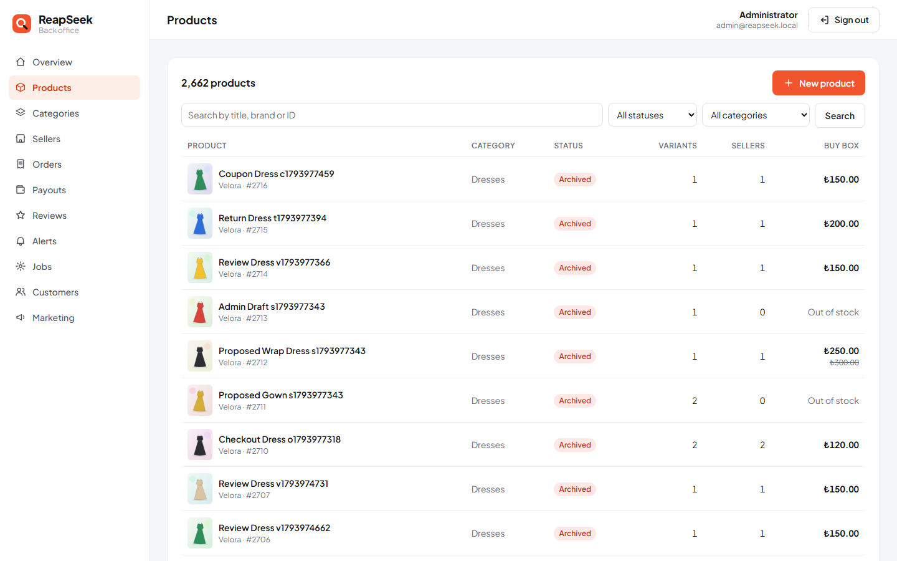

| Product with competing offers | Back office overview |
|---|---|
| 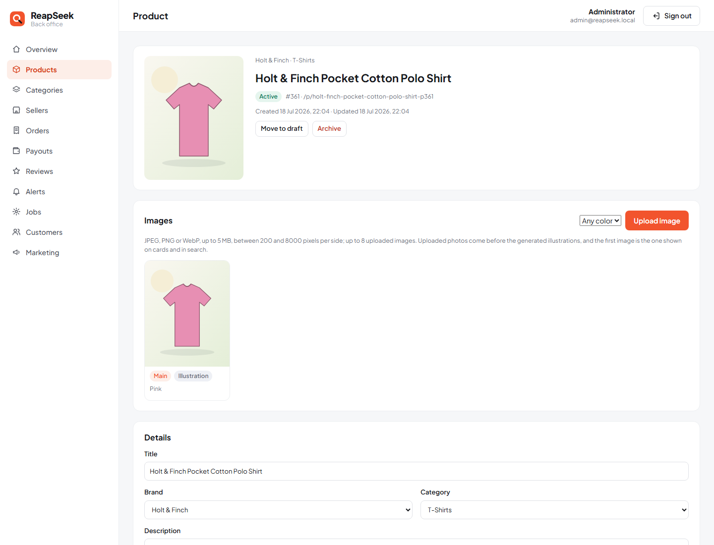 | 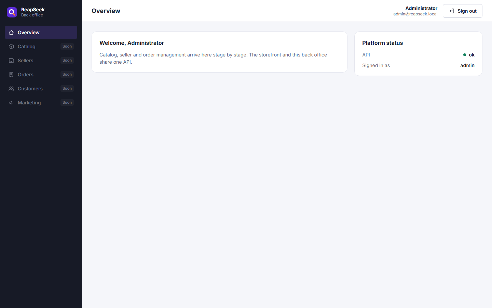 |

### Search

Search and every category page run on OpenSearch. The worker keeps one document per active product with its buy box price, discount, stock state, colors, sizes and category ancestors.

- **Language:** English stemming, accent folding (`cafe` finds "Café"), search-time synonyms (`tee` → t-shirt, `couch` → sofa, `sneakers` → trainers) and typo tolerance for words of four letters or more (`dreses`, `sneekers`, `laptp`). A query can mix fields: `velora linen` matches the brand and the material.
- **Facets:** category, brand, color, size and price. Multi-select facets are counted without their own filter, so picking "Black" still shows how many navy products there are; the price range shows the full range of the other filters.
- **Sorting:** best match, price both ways, biggest discount and newest; out-of-stock products always come last and can be hidden.
- **Suggestions:** as-you-type product, brand and category suggestions from a `search_as_you_type` field, with keyboard navigation.
- **Color-aware cards:** filtering by a color shows each product's image in that color.
- **Indexing:** catalog changes flow through the same outbox as the ReapDeep sync and reach search within a second. A full rebuild creates a new index, fills it, swaps the `products` alias atomically and deletes the old index, so search never goes down; the worker rebuilds by itself when the index is missing or its mapping version changes.
- **No JavaScript needed** for filtering or paging: facets are plain links and the price filter is a form, so every listing state has a crawlable URL. Category pages carry canonical URLs; search pages are `noindex`.

| Category page with filters | Suggestions while typing |
|---|---|
| 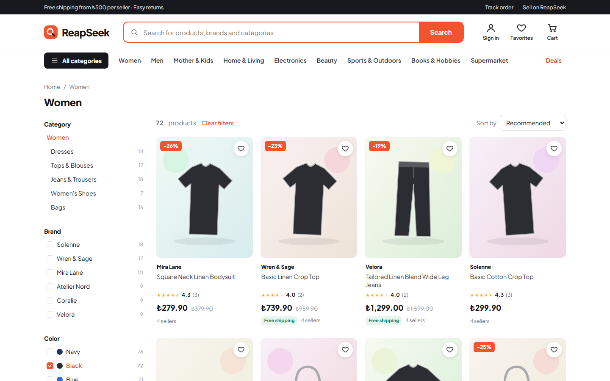 | 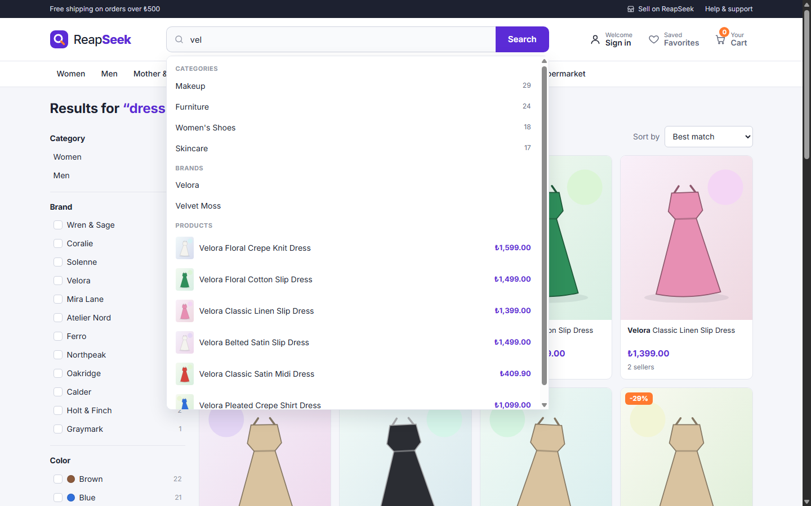 |

### Product page

`/p/{slug}` is rendered on the server from the storefront product API, which only exposes what a shopper may see: active offers from active sellers that are in stock, the buy box per variant, a discount and a "low stock" hint (the exact stock stays private).

- **Variants:** color swatches and size chips in size-chart order; combinations without a seller are crossed out, choosing a color switches the gallery to that color, and the selection is kept in the URL (`?variant=`).
- **Sellers:** the buy box seller with rating, handling time and an estimated delivery date (business days, computed from the shop's time zone so the server and the browser agree), plus every other seller of the variant, sorted by price.
- **SEO:** `Product` and `BreadcrumbList` JSON-LD with an aggregate offer, canonical URL, Open Graph image, and a generated `sitemap.xml` and `robots.txt`.

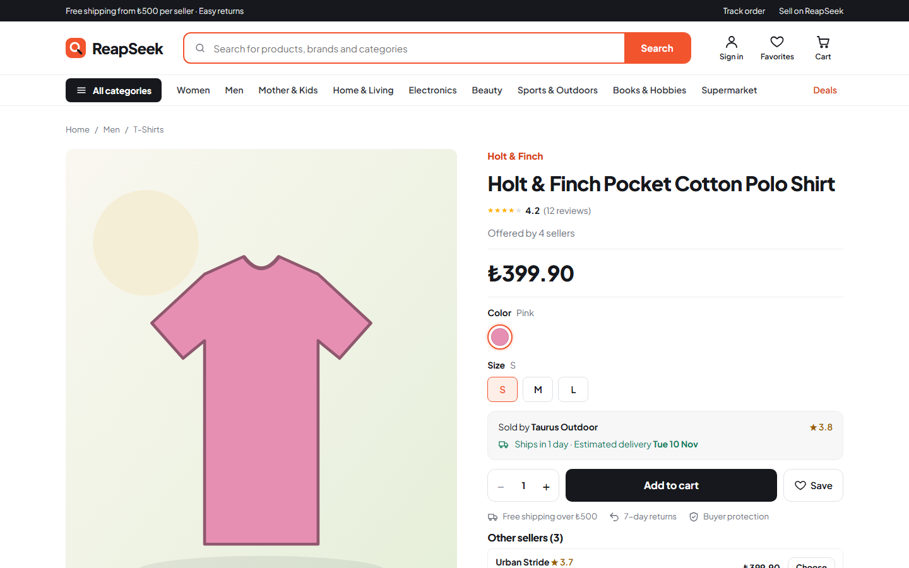

### Cart and checkout

- **Cart:** guests get a cart behind an httpOnly `rs_cart` cookie (30 days); signing in or registering merges it into the customer's cart. Up to 10 of one item and 50 lines. The cart is always priced live against the current offers: a price change is shown next to the price at the time the item was added, and lines that are low on stock or no longer sold are flagged and block checkout until they are fixed.
- **Per-seller packages:** the cart and the order are grouped by seller. Each seller's package ships separately, with free shipping from ₺500 per package and ₺39.90 below it.
- **Checkout:** the customer confirms the total they saw (`expected_total`). The API locks the offers, prices the cart again, rejects the order if anything changed, reserves stock with a conditional update and writes the order in one transaction. Order numbers look like `RS261030000123`.
- **Payment:** the customer is redirected to the provider's hosted payment page, so card data never reaches ReapSeek. The order has 15 minutes to be paid; after that the worker cancels it and returns the stock. If the payment provider cannot be reached the order is closed at once and the stock is returned.
- **Confirmation:** the provider's webhook marks the order paid, moves the packages to "preparing", removes the purchased items from the cart and, through the outbox, sends the confirmation email and the `purchase` events to ReapDeep. The result page waits for the webhook and shows the outcome.
- **Back office:** orders with status and search filters, per-seller packages, the address and every payment attempt with its failure reason.

### Payments: `ReapSeek.Sandbox`

A separate Native AOT service that behaves like a real card payment provider:

- `POST /v1/payments` with a secret key creates a payment and returns a hosted page URL; the page asks for the card and then for a 3-D Secure code (`123456`).
- Test cards: `4242 4242 4242 4242` succeeds, `4000 0000 0000 0002` is declined, `4000 0000 0000 9995` has insufficient funds.
- Results arrive as webhooks signed with HMAC-SHA256 in the `Sandbox-Signature: t=...,v1=...` format, retried after 1, 5 and 15 seconds. ReapSeek rejects signatures older than five minutes, records every event id so a replayed webhook is applied once, and checks that the paid amount matches the order.

| Cart | Hosted payment page |
|---|---|
| 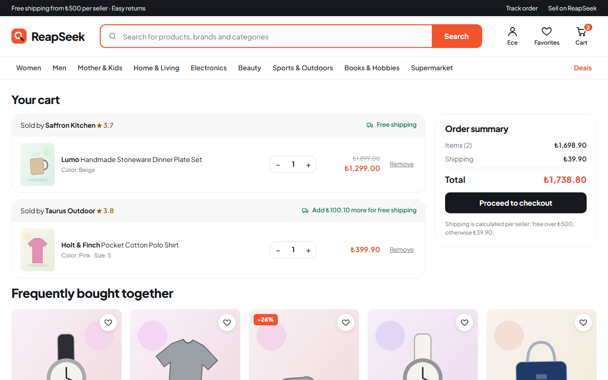 | 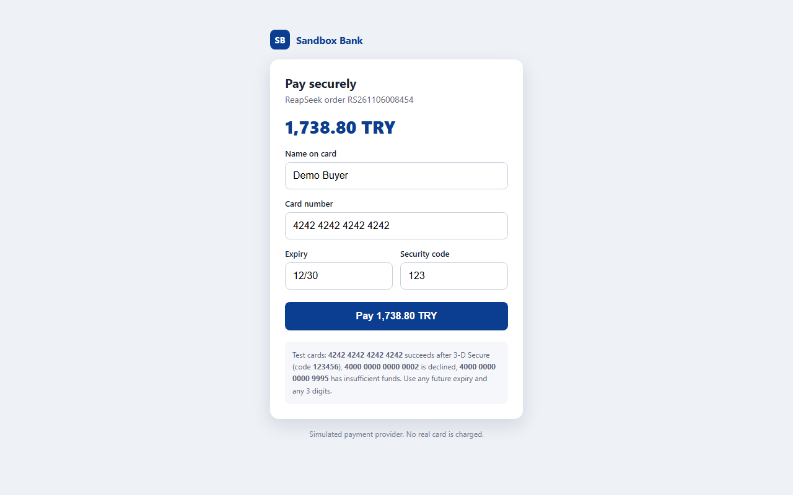 |

| Order confirmed | Back office order |
|---|---|
| 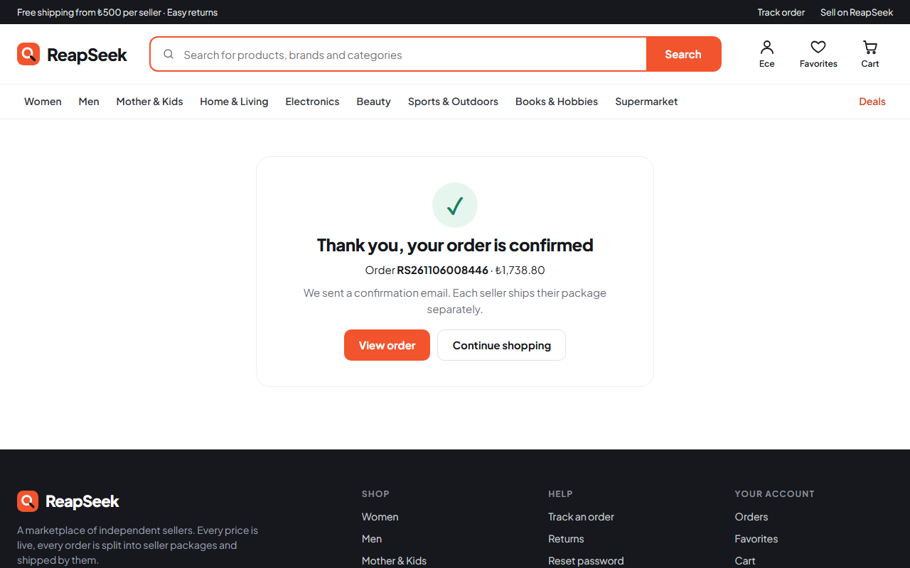 | 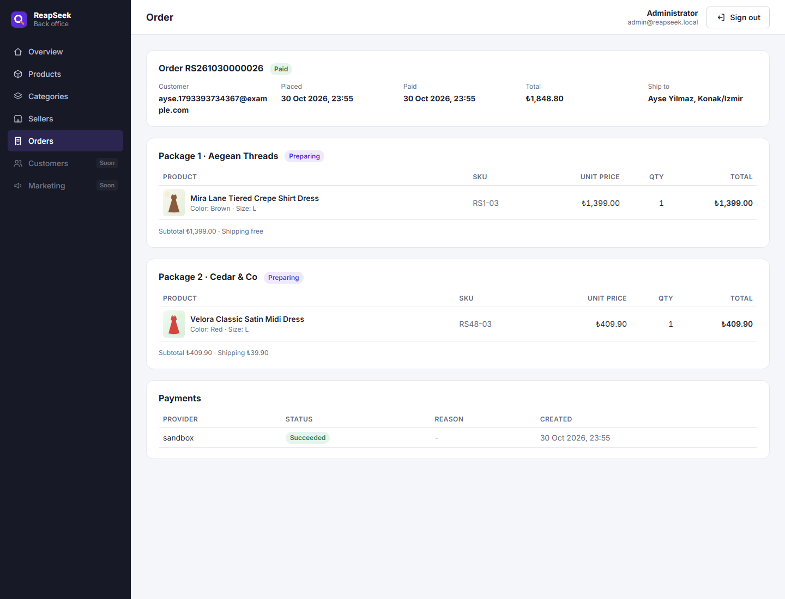 |

### Behavioral analytics with ReapDeep

The storefront uses the ReapDeep JS SDK (vendored as `storefront/vendor/reapdeep-js-0.1.0.tgz`, packed from the ReapDeep repository) and sends events straight from the browser to ReapDeep's ingestion API.

| Event | When | Main properties |
|---|---|---|
| `$pageview` | every page, including client-side navigation | URL and referrer (SDK) |
| `search_performed` | a search results page is shown | `query`, `results`, `category`, `brands`, `colors`, `sizes`, `sort`, `page` |
| `search_result_clicked` | a result card is clicked | `query`, `item_id`, `position`, `price` |
| `search_suggestion_clicked` | a suggestion is picked | `query`, `type`, `value` |
| `product_viewed` | a product page is opened | `item_id`, `price`, `category`, `department`, `brand`, `seller_id`, `in_stock` |
| `add_to_cart` | an item is added from the product page | `item_id`, `offer_id`, `seller_id`, `price`, `quantity` |
| `checkout_started` | the checkout page is opened | `value`, `items`, `sellers` |
| `purchase` | sent by the worker when an order is paid, one per order line | `item_id`, `order_id`, `price`, `quantity`, `amount`, `seller_id` |

`item_id` is the ReapSeek product id, the same key the catalog sync uses, so ReapDeep can join behavior with the catalog for recommendations. Purchases are sent from the server rather than the browser, so they are counted even when the customer closes the tab after paying; each line has a stable `event_id`, so a retry never counts twice.

- **Identity:** when a customer signs in, the storefront calls `identify("customer-{id}")`; ReapDeep links the anonymous browsing history to the customer. Signing out calls `reset()`, so the next visitor on the same browser starts with a new anonymous id. Identity is synchronized before any page event is sent.
- **Configuration:** the public key and the ingestion and recommender URLs come from `deploy/local/.env` (written by `connect-reapdeep.ps1`); without them the storefront runs without tracking.

### ReapDeep catalog sync

Every change that affects what shoppers see (a product edit, a status change, an offer, a seller suspension) writes a `products_changed` message to the outbox in the same transaction. The worker batches these messages and sends the affected products to ReapDeep's catalog API with a `catalog_write` key: active products are upserted with their buy box price, stock status, storefront URL and image; drafts and archived products are removed. A full sync runs after seeding and after connecting.

`deploy/local/connect-reapdeep.ps1` connects a running ReapSeek stack to a running ReapDeep stack the way any customer would: it signs in to ReapDeep, creates a `ReapSeek` project through ReapDeep's API, creates the API keys and writes them to `deploy/local/.env`.

## Repository layout

```
src/
  ReapSeek.Api/        Minimal API (feature folders: Identity, Catalog, Search, Carts, Checkout, Orders, Payments, ...)
  ReapSeek.Domain/     Domain model for carts, orders and money, no dependencies
  ReapSeek.Worker/     Outbox processor, emails, search indexing, ReapDeep sync and purchase events, payment expiry
  ReapSeek.Shared/     Migrations, outbox contracts, order persistence, Redis cache, validation helpers
  ReapSeek.Sandbox/    Simulated payment provider
storefront/            Next.js storefront
backoffice/            React back office
deploy/local/          Docker Compose stack and end-to-end tests
tests/                 Unit tests
```

## Running locally

Requirements: Docker Desktop, PowerShell (Windows) and, for development outside Docker, the .NET 10 SDK and Node.js 22+.

```powershell
cd deploy/local
.\run-local.ps1
```

The script creates `deploy/local/.env` with random passwords on the first run, builds the images, starts the stack and seeds the demo catalog (skipped when the catalog already has data; `docker compose run --rm migrate --seed --reset` replaces it).

To feed ReapDeep, start the [ReapDeep](https://github.com/guvenimat/ReapDeep) stack as well and run:

```powershell
.\connect-reapdeep.ps1
```

| Service | URL |
|---|---|
| Storefront | http://localhost:3100 |
| Back office | http://localhost:3101 (admin credentials are in `deploy/local/.env`) |
| API | http://localhost:8100 |
| Payment sandbox | http://localhost:8101 |
| Mailpit | http://localhost:8025 |
| OpenSearch | http://localhost:9200 |
| Redis | localhost:6380 (password in `deploy/local/.env`) |

## Tests

```powershell
dotnet test tests/ReapSeek.UnitTests
cd deploy/local
.\auth-test.ps1
.\catalog-test.ps1
.\search-test.ps1
.\product-test.ps1
.\checkout-test.ps1
.\scale-test.ps1
```

The scripts run end to end against the running stack.

- `auth-test.ps1`: registration, sign-in, session separation, password change, the welcome email arriving in Mailpit through the outbox, server-rendered storefront pages and the sign-in rate limit.
- `catalog-test.ps1`: access rules, the seeded catalog, category, brand and seller rules, the variant matrix, the buy box under price, stock, pause and suspension changes, search and filters, the sync to ReapDeep (publish, price change, seller suspension, archive) and the image endpoints.
- `search-test.ps1`: index consistency, typos, synonyms, accents and mixed-field queries, facet counts, sorting and paging, suggestions, the index following catalog changes, a zero-downtime rebuild and the server-rendered storefront pages.
- `product-test.ps1`: the storefront product API (hidden offers, buy box, low stock), the server-rendered product page and its structured data, the sitemap, and a real headless Chrome session (`tools/browse.mjs`) that searches, clicks a result, signs in and out, then checks in ReapDeep that every event arrived and that the anonymous visitor and the customer became one person.
- `scale-test.ps1` (needs the second instance: `docker compose --profile scale up -d`): the sign-in limit shared between two instances, sign-out and password change taking effect on the other instance at once, product page and category tree invalidation across instances, and a Redis outage.
- `checkout-test.ps1`: cart rules, prices and stock changes, the guest cart merge, checkout validation, a full payment with 3-D Secure (stock, packages, webhook signature and replay, cart cleanup, confirmation email, back office, `purchase` events in ReapDeep), declined cards, the payment timeout, a payment provider outage, and a headless Chrome session that buys a product from the product page to the confirmation page.

## License

Apache License 2.0. See [LICENSE](LICENSE) and [NOTICE](NOTICE).
