# ReapSeek

A multi-seller marketplace in the style of large e-commerce sites: a canonical product catalog with variants and competing seller offers, search with facets, cart and checkout, orders split into per-seller packages, payments, shipping, returns, reviews and a seller back office.

ReapSeek is the flagship customer of [ReapDeep](https://github.com/guvenimat/ReapDeep), a multi-tenant product analytics platform. It uses ReapDeep only through its public interfaces, exactly as any other customer would:

- the ReapDeep JS SDK for page views, product views, cart and search events;
- server-side `purchase` and `refund` events from the order pipeline;
- the catalog API to keep ReapDeep's product catalog in sync;
- the ReapDeep Recommender for "similar items", "frequently bought together", popular and trending lists;
- RFM segments and cohorts for coupon targeting and email campaigns;
- ReapDeep alerts, delivered to ReapSeek as signed webhooks.


**Highlights**

- **Marketplace model:** one product, many variants, competing seller offers and a buy box; orders split into per-seller packages with their own shipping, tracking, returns and payouts.
- **Money handled carefully:** a framework-free domain model for carts, orders, returns, coupons and seller settlement, a seller ledger and weekly payouts, idempotent signed webhooks.
- **Reliable side effects:** a transactional outbox drives search indexing, email, ReapDeep sync and refunds; failed jobs can be retried from the back office.
- **Built to scale out:** a stateless .NET 10 Native AOT API (runs as several instances), shared state in Redis, OpenSearch for search, OpenTelemetry traces from the browser click to the worker.
- **Analytics in the loop:** behavioral events, recommendations, RFM-targeted coupon campaigns and alerts, all through ReapDeep's public APIs.
- **Enforced architecture:** architecture tests and [decision records](docs/adr) keep the modular monolith honest.
- **Realistic data:** a shopping simulator creates two thousand customers and six thousand orders, so every screen and chart has something to show.

## Quick start

You need Docker Desktop and PowerShell. On Windows:

```powershell
git clone https://github.com/guvenimat/ReapSeek.git
cd ReapSeek/deploy/local
.\run-local.ps1
docker compose --profile simulator run --rm simulator backfill
```

Then open the storefront at http://localhost:3100 and the back office at http://localhost:3101 (the admin password is in `deploy/local/.env`). Simulated shoppers sign in with `shopper-pass-1`, sellers with `seller-pass-1`; pay with the test card `4242 4242 4242 4242` and the 3-D Secure code `123456`. More in [Running locally](#running-locally).

## Architecture

| Component | Technology |
|---|---|
| Storefront | Next.js (server-side rendering), TypeScript |
| Back office (admin and sellers) | React, Vite, TypeScript |
| API | .NET 10 Minimal API, Native AOT, modular monolith |
| Background jobs | .NET 10 worker with a transactional outbox |
| Database | PostgreSQL, versioned SQL migrations |
| Search | OpenSearch |
| Cache and shared limits | Redis (StackExchange.Redis) |
| Payments | `ReapSeek.Sandbox`, a simulated payment provider with hosted payment pages and signed webhooks |
| Email | Mailpit (local) |
| Analytics and recommendations | ReapDeep |

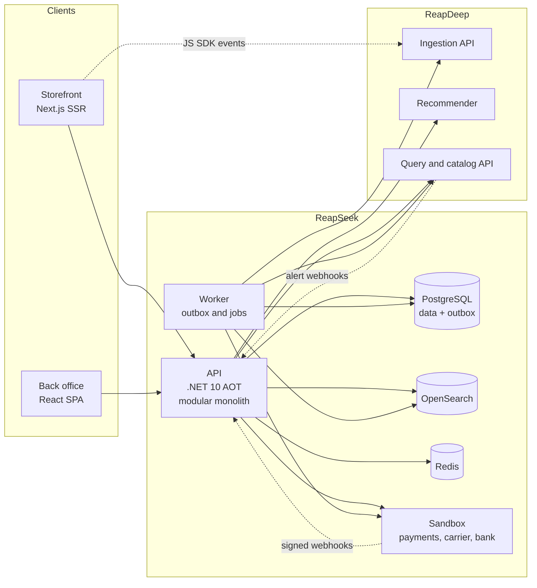

### Code architecture

The backend is a **modular monolith**: one API (stateless, so it can run as several instances behind a load balancer) and one worker, with code organized by feature (`Catalog/`, `Search/`, `Carts/`, `Checkout/`, `Orders/`, `Payments/`, ...) rather than by technical layer. Each feature keeps the same three kinds of classes: `*Endpoints` (routes and access rules, no SQL), a service or pure logic class, and a repository (Dapper with compile-time generated mapping, so everything runs under Native AOT). The architecture is not uniform on purpose; each area uses the simplest style that carries its rules:

| Area | Style | Why |
|---|---|---|
| Catalog, search, accounts, back office reads | Feature folders, services and SQL read models | Mostly CRUD and queries. The rules (buy box, listing visibility) are best expressed in SQL, close to the data; an object model would only add mapping. |
| Cart, orders, payments, returns, coupons, seller settlement | Rich domain model in `ReapSeek.Domain` | These carry the business invariants: quantity and line limits, per-seller packages and shipping, money arithmetic, the order state machine, idempotent payment confirmation. Getting them wrong costs money, so they live in aggregates that cannot be put into an invalid state. |
| Side effects (email, search indexing, ReapDeep sync, purchase events, cache invalidation) | Transactional outbox, processed by the worker | A side effect never happens for a change that was rolled back, and none is lost when an external system is down. |
| State shared between API instances (rate limits, session and page caches) | Redis, always optional | Instances keep no state of their own that another instance could contradict. If Redis is down the API keeps working from PostgreSQL. |

`ReapSeek.Domain` has no package references and knows nothing about HTTP, SQL or JSON:

- **Value objects:** `Money` (non-negative, one currency, rounded half away from zero), `ShippingAddress` (validated on creation).
- **Aggregates:** `Cart` (lines, merge of a guest cart on sign-in) and `Order` with its `SellerPackage`s. State changes go through methods such as `Order.MarkPaid(reference, amount, at)`, which checks the transition, the amount and replays of the same payment.
- **Coupons:** `Coupon.DiscountFor` checks the owner, single use, expiry and minimum basket and computes a percentage (rounded, optionally capped) or fixed discount; `Order.Place` takes it as an `OrderDiscount`, and the total is items + shipping - discount.
- **Returns:** `ReturnRequest` checks the 7-day window after delivery, the quantity still returnable per line and the reason, and moves through requested → approved or rejected → received → refunded. `MarkRefunded` returns the ledger entries for the refund.
- **Settlement:** `Settlement.ForPackage` turns a delivered package into ledger entries (sale, shipping fee, commission) and `PayoutPeriod` finds the Monday that closes a payout week.
- **Domain events:** `OrderPlaced`, `OrderPaid`, `OrderPaymentFailed`, `OrderCancelled`, `PackageShipped`, `PackageDelivered`, and `ReturnRequested` ... `ReturnRefunded`. The persistence layer (`ReapSeek.Shared/Ordering/OrderStore`) writes them to the outbox in the same transaction as the order, and events that release stock return it in that transaction too.
- **Unit tested** without a database: every rule has a test in `DomainTests.cs`.

There is deliberately no generic repository, mediator or separate application layer: the endpoints call a service, the service loads an aggregate, calls one of its methods and saves it.

External providers sit behind three ports in `ReapSeek.Shared/Providers`: `IPaymentGateway`, `ICarrier` and `IPayoutBank`, all implemented today by the Sandbox adapter. Email, search and caching are not abstracted, because there is no second implementation to swap in.

The rules above are enforced, not just documented: `ArchitectureTests.cs` (NetArchTest) fails the build when the domain references a framework, an endpoint class runs SQL, a repository is used outside its module group, or code outside a composition root references the Sandbox adapter. The reasoning behind each choice is recorded in [`docs/adr`](docs/adr): [modular monolith](docs/adr/0001-modular-monolith.md), [hybrid architecture](docs/adr/0002-hybrid-architecture.md), [transactional outbox](docs/adr/0003-transactional-outbox.md), [ReapDeep through public interfaces](docs/adr/0004-reapdeep-public-interfaces.md) and [ports at real boundaries](docs/adr/0005-ports-at-real-boundaries.md).

### What is built so far

- **Accounts:** customer registration and sign-in, PBKDF2 password hashing, password change that signs out other devices, rate-limited sign-in, email verification and password reset (below).
- **Separate sessions for the storefront and the back office:** different cookies (`rs_session` with `SameSite=Lax` for 30 days, `rs_bo_session` with `SameSite=Strict` for 12 hours), so a customer session never opens the back office.
- **Transactional outbox:** the API writes domain messages in the same transaction as the data; the worker claims them with `FOR UPDATE SKIP LOCKED` and a lease, retries with exponential backoff and gives up after 10 attempts. A job that gives up queues an email to the admins in the same statement, and the back office **Jobs** page shows pending, retrying, failed and discarded jobs per type with the payload and the last error, so a failure can be retried (one job or every failed job of a type) or discarded once its cause is understood.
- **Migrations:** SQL files embedded in `ReapSeek.Shared`, applied in order under an advisory lock by a one-shot `migrate` container before the API and the worker start.
- **Storefront:** server-rendered pages throughout: the header with the signed-in customer and a category menu from the catalog, a home page with deals and new arrivals, search and category listings, sign-in, registration and account pages.
- **Back office:** one React app with two roles. Staff manage the catalog, sellers, orders and payouts; sellers get the seller center described below.

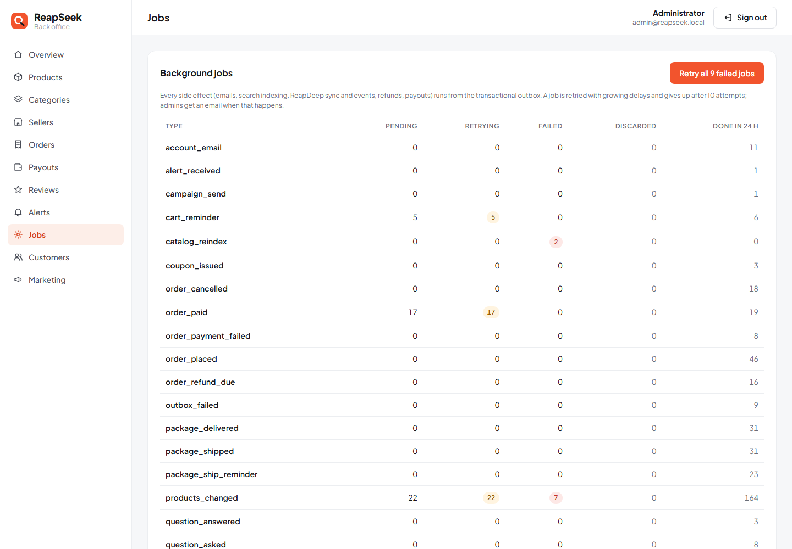

### Caching and running several API instances

The API keeps no state in process memory, so any number of instances can serve the same traffic (`docker compose --profile scale up -d` starts a second one on port 8102). What has to be shared lives in Redis:

| Key | What | TTL | Invalidated by |
|---|---|---|---|
| `ratelimit:auth:{ip}` | sign-in and registration attempts per client, counted across all instances (atomic Lua `INCR` + `PEXPIRE`), `Retry-After` on 429 | 1 minute window | expiry |
| `session:{token hash}` | the user behind a session cookie | 60 seconds | sign-out, and a password change for every other session of the user |
| `reco:{model}:{product id}` | the last product id list from the ReapDeep Recommender (`reco:for_you:customer-{id}` for a shopper's personal list) | fresh for 5 minutes (30 s locally), kept 24 hours as a stale copy | expiry; ReapDeep retrains on its own schedule |
| `product:{slug}` | the storefront product page (product, variants, offers, buy box) | 5 minutes | the worker, on every `products_changed` outbox message: price, stock, order placement, seller suspension, archive |
| `catalog:categories` | the category tree used by the menu, search and facets | 10 minutes | category changes, catalog rebuilds |

- **PostgreSQL stays the source of truth.** Every entry is a copy with a TTL; invalidation deletes it and the next read loads it again (cache-aside). A change that bypasses the outbox, such as a manual SQL update, shows once its TTL runs out.
- **Invalidation through the outbox:** product pages are invalidated by the worker in the same batch that updates search and ReapDeep, so every change that reaches search also reaches the cache. A failed deletion is logged and does not hold up search or the ReapDeep sync; the entry then expires with its TTL (and a restarted Redis starts empty).
- **Redis is never required.** If it is unreachable, reads go to PostgreSQL, each instance falls back to its own in-memory rate limit, and errors are logged; the test suite stops Redis and checks that the storefront, sign-in and search keep working.
- **Why not a two-level cache:** an in-process copy on each instance would need a broadcast to stay correct after sign-out or a price change; one shared copy is simpler and fast enough here.

### Observability

The API, the worker and the payment sandbox export traces, metrics and logs with OpenTelemetry (OTLP) to a local Grafana stack (`grafana/otel-lgtm`: Tempo, Prometheus, Loki and Grafana in one container) at http://localhost:3102. Telemetry is off when `OTEL_EXPORTER_OTLP_ENDPOINT` is not set.

- **One trace across processes and the outbox:** HTTP calls carry the W3C `traceparent`, and every outbox row stores the trace of the request that queued it. The worker continues that trace when it handles the job, so a payment reads as one trace: the 3-D Secure form post in the sandbox, its webhook to the API, the database writes, the `outbox order_paid` job in the worker and its call to ReapDeep.
- **Metrics:** ASP.NET Core, HttpClient, Npgsql and .NET runtime metrics, plus business and job metrics (`reapseek.orders.placed`, `reapseek.orders.paid`, `reapseek.orders.revenue`, `reapseek.payments.failed` by reason, `reapseek.outbox.processed` by type and outcome, `reapseek.outbox.delay` from enqueue to done).
- **Dashboard:** the provisioned *ReapSeek overview* dashboard (`deploy/k8s/chart/reapseek/files/reapseek-overview.json`) shows the checkout funnel, revenue, failed payments, requests and p95 latency per route, outgoing calls per host, background jobs per type, retries and give-ups, database latency and connections, memory, and recent warnings and errors from the logs.

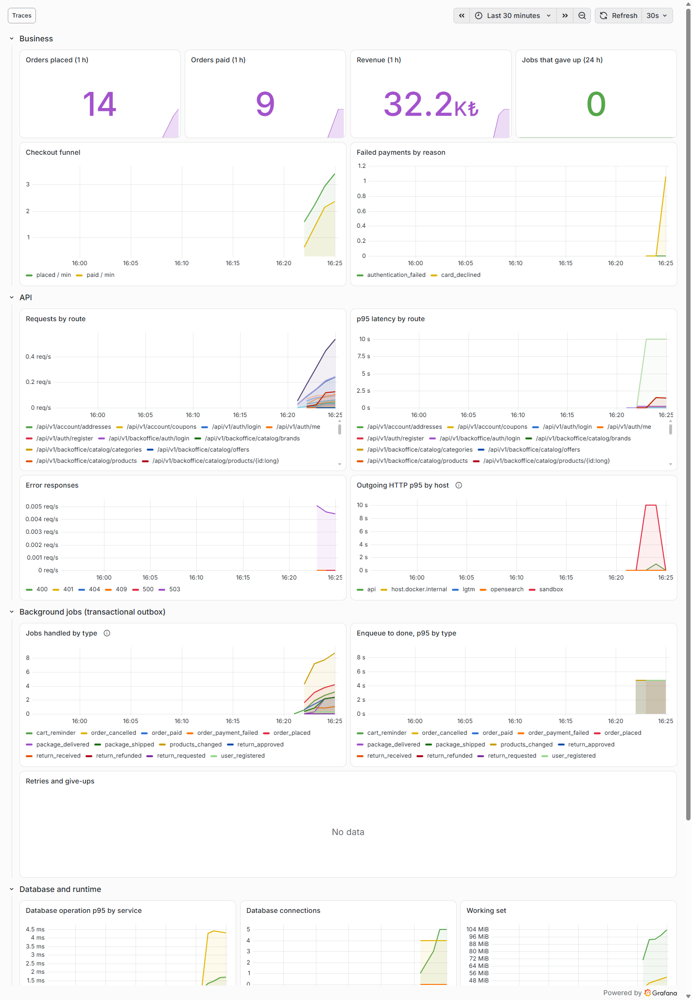

### Marketplace catalog

The catalog follows the model of large marketplaces: one canonical **product** (title, brand, category, attributes, images) has **variants** (every combination of its axes, such as color and size, each with a SKU), and any number of **sellers** compete on each variant with their own **offer** (price, list price, stock, handling time).

- **Buy box:** for each variant the winning offer is the cheapest one that is active, in stock and from an active seller; ties go to the higher-rated seller, then the faster one. Pausing an offer, running out of stock or suspending a seller hands the buy box to the next offer immediately. The product's price is its cheapest buy box.
- **Seller rating:** computed by the worker from the reviews of the last 180 days, each one counted for the seller that delivered the product to the reviewer. It is a Bayesian average, `(10 × platform mean + sum of ratings) / (10 + number of reviews)`, where the platform mean is the average of all those reviews (4.0 before there are any): a new seller starts at the platform average, and one five-star review cannot put it on top. When a rating changes, the seller's products go through the outbox again, so search, the product cache and the buy box follow.
- **Categories:** departments and subcategories (up to three levels); products live in subcategories, and filtering a department includes everything below it.
- **Product images:** generated by the API as SVG illustrations, one per color, in a style chosen per category (`/media/catalog/{kind}/{color}/{seed}.svg`, cached as immutable). No stock photos with restrictive licenses are bundled.
- **Photo uploads:** staff can add photos to any product and sellers to their own proposals until they are approved. The API checks the file itself, not its name or declared type: only JPEG, PNG and WebP, read from the file header together with the pixel size (200 to 8000 per side, at most 5 MB, at most 8 photos per product). Files get random names, live on a volume shared by all API instances and are served as `/media/uploads/{name}` with `nosniff` and an immutable cache. Photos come before the generated illustrations, any image can be made the main one, and every change updates search, the product cache and ReapDeep through the outbox.
- **Demo data:** `--seed` creates a deterministic catalog of about 2,400 products, 9,500 variants and 17,000 offers from 14 sellers across 9 departments, in under two seconds.


| Product with competing offers | Back office overview |
|---|---|
|  |  |

### Search

Search and every category page run on OpenSearch. The worker keeps one document per active product with its buy box price, discount, stock state, colors, sizes and category ancestors.

- **Language:** English stemming, accent folding (`cafe` finds "Café"), search-time synonyms (`tee` → t-shirt, `couch` → sofa, `sneakers` → trainers) and typo tolerance for words of four letters or more (`dreses`, `sneekers`, `laptp`). A query can mix fields: `velora linen` matches the brand and the material.
- **Facets:** category, brand, color, size and price. Multi-select facets are counted without their own filter, so picking "Black" still shows how many navy products there are; the price range shows the full range of the other filters.
- **Sorting:** best match, price both ways, biggest discount and newest; out-of-stock products always come last and can be hidden.
- **Suggestions:** as-you-type product, brand and category suggestions from a `search_as_you_type` field, with keyboard navigation.
- **Color-aware cards:** filtering by a color shows each product's image in that color.
- **Indexing:** catalog changes flow through the same outbox as the ReapDeep sync and reach search within a second. A full rebuild creates a new index, fills it, swaps the `products` alias atomically and deletes the old index, so search never goes down; the worker rebuilds by itself when the index is missing or its mapping version changes.
- **No JavaScript needed** for filtering or paging: facets are plain links and the price filter is a form, so every listing state has a crawlable URL. Category pages carry canonical URLs; search pages are `noindex`.

| Category page with filters | Suggestions while typing |
|---|---|
|  |  |

### Product page

`/p/{slug}` is rendered on the server from the storefront product API, which only exposes what a shopper may see: active offers from active sellers that are in stock, the buy box per variant, a discount and a "low stock" hint (the exact stock stays private).

- **Variants:** color swatches and size chips in size-chart order; combinations without a seller are crossed out, choosing a color switches the gallery to that color, and the selection is kept in the URL (`?variant=`).
- **Sellers:** the buy box seller with rating, handling time and an estimated delivery date (business days, computed from the shop's time zone so the server and the browser agree), plus every other seller of the variant, sorted by price.
- **SEO:** `Product` and `BreadcrumbList` JSON-LD with an aggregate offer, canonical URL, Open Graph image, and a generated `sitemap.xml` and `robots.txt`.


### Cart and checkout

- **Cart:** guests get a cart behind an httpOnly `rs_cart` cookie (30 days); signing in or registering merges it into the customer's cart. Up to 10 of one item and 50 lines. The cart is always priced live against the current offers: a price change is shown next to the price at the time the item was added, and lines that are low on stock or no longer sold are flagged and block checkout until they are fixed.
- **Per-seller packages:** the cart and the order are grouped by seller. Each seller's package ships separately, with free shipping from ₺500 per package and ₺39.90 below it.
- **Checkout:** the customer confirms the total they saw (`expected_total`). The API locks the offers, prices the cart again, rejects the order if anything changed, reserves stock with a conditional update and writes the order in one transaction. Order numbers look like `RS261030000123`.
- **Payment:** the customer is redirected to the provider's hosted payment page, so card data never reaches ReapSeek. The order has 15 minutes to be paid; after that the worker cancels it and returns the stock. If the payment provider cannot be reached the order is closed at once and the stock is returned.
- **Confirmation:** the provider's webhook marks the order paid, moves the packages to "preparing", removes the purchased items from the cart and, through the outbox, sends the confirmation email and the `purchase` events to ReapDeep. The result page waits for the webhook and shows the outcome.
- **Back office:** orders with status and search filters, per-seller packages, the address and every payment attempt with its failure reason.

### Payments: `ReapSeek.Sandbox`

A separate Native AOT service that behaves like a real card payment provider:

- It also plays the carrier and the bank: `POST /v1/shipments` returns a tracking number and then moves the parcel through its steps on a timer (5 seconds locally), sending a signed webhook for each; `POST /v1/payments/{id}/refunds` refunds part of a payment; `POST /v1/transfers` pays a seller.
- `POST /v1/payments` with a secret key creates a payment and returns a hosted page URL; the page asks for the card and then for a 3-D Secure code (`123456`).
- Test cards: `4242 4242 4242 4242` succeeds, `4000 0000 0000 0002` is declined, `4000 0000 0000 9995` has insufficient funds.
- Results arrive as webhooks signed with HMAC-SHA256 in the `Sandbox-Signature: t=...,v1=...` format, retried after 1, 5 and 15 seconds. ReapSeek rejects signatures older than five minutes, records every event id so a replayed webhook is applied once, and checks that the paid amount matches the order.
- Its state lives in its own `sandbox` database on the same PostgreSQL server (created on start, never touched by ReapSeek), so payments, refunds, parcels in transit and transfers survive a restart. State changes are conditional updates, so a double-submitted card form or two refunds racing for the same payment cannot overshoot.

| Cart | Hosted payment page |
|---|---|
|  |  |

| Order confirmed | Back office order |
|---|---|
|  |  |

### Seller center, ledger and payouts

Sellers sign in to the same back office as staff and see only their own data (`/api/v1/seller/*`, every query filtered by the seller of the signed-in user).

| Earnings | Packages to ship |
|---|---|
| 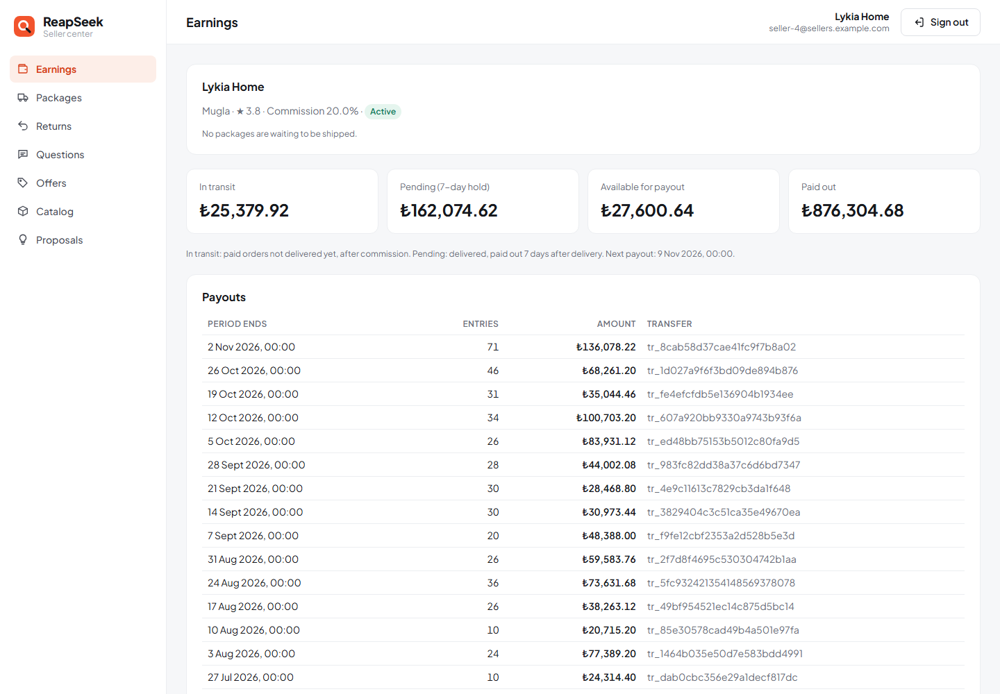 | 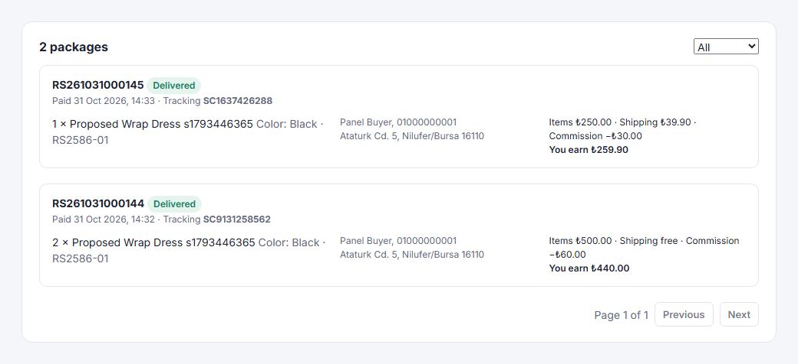 |

- **Offers:** a seller finds a product in the catalog and sets price, list price, stock and handling days per variant. They see the current buy box price but never their competitors' stock.
- **Product proposals:** a product that is not in the catalog yet is proposed as `pending_review`; the seller can price it at once, and it goes on sale when staff approve it. A rejection needs a note, which the seller sees.
- **Shipping:** a paid package appears under "Packages to ship" with the address and items. "Ship" asks the Sandbox carrier for a tracking number, moves the package to `shipped` through the `Order` aggregate and emails the customer. The carrier then reports every step (in transit, out for delivery, delivered) as a signed webhook; delivery is never set by hand.
- **Ledger:** when a package is delivered, the sale, the shipping fee and the commission (rate fixed on the package when the order is placed, rounded half away from zero) are written to `seller_ledger` in the same transaction. The money stays pending for 7 days, the return window.
- **Payouts:** every Monday at 00:00 Turkey time the worker pays each seller the entries that became available before that Monday, as one `payouts` row and a Sandbox bank transfer. The run is idempotent (one payout per seller and week, transfers retried until they succeed) and staff can trigger it from the back office.

### Tracking, returns and refunds

| Order page: tracking and a return | Seller center: returns |
|---|---|
| 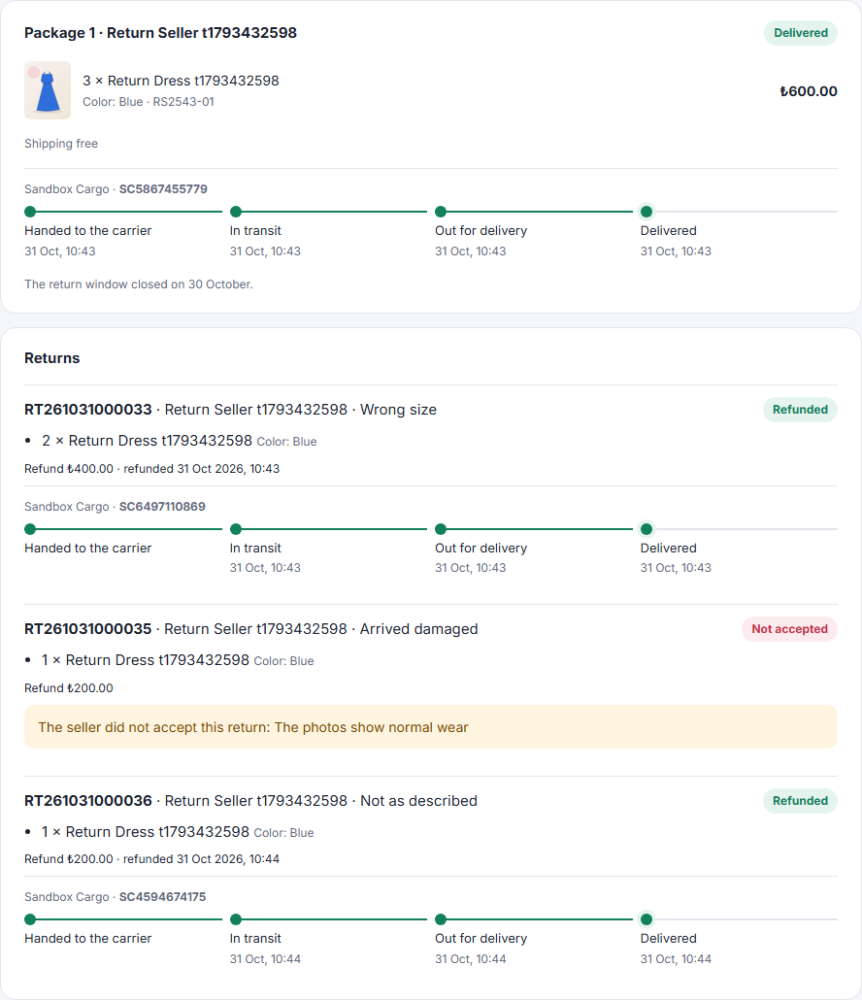 | 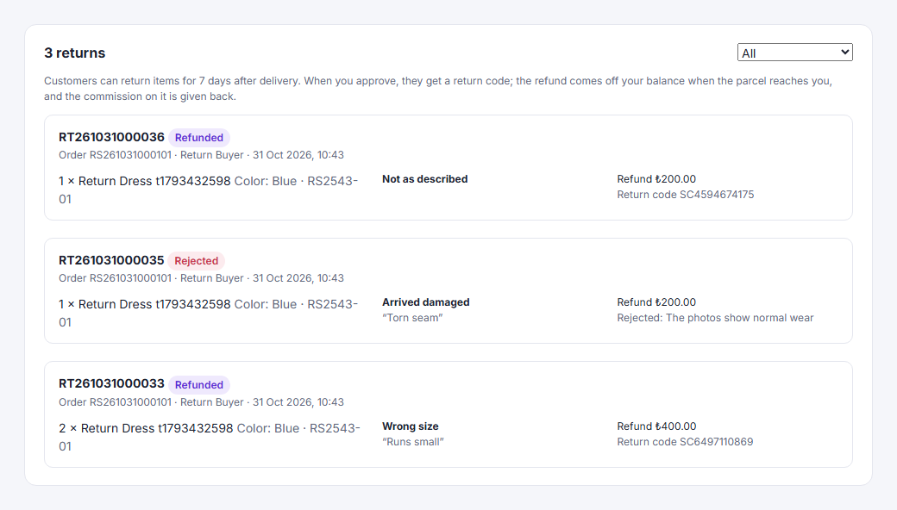 |

- **Tracking:** carrier events arrive at `POST /api/v1/shipping/sandbox/webhook`, signed like the payment webhooks. Every event id is stored, so a replay is applied once. The customer's order page shows each step; the `delivered` event delivers the package through the `Order` aggregate and writes the seller ledger in the same transaction.
- **Asking for a return:** for 7 days after delivery the customer picks items and quantities and a reason on the order page. Items already in an open or finished return cannot be asked for twice; a rejected item can.
- **The seller decides:** the request appears under Returns in the seller center (and by email). Approving asks the carrier for a return code, which the customer gets by email; rejecting needs a note the customer sees.
- **Refund:** when the carrier reports the return as delivered to the seller, the worker refunds the card through the Sandbox payment API (idempotent per return) and writes `refund` and `commission_refund` entries to the seller ledger; shipping fees are not refunded. A server-side `refund` event per item goes to ReapDeep, which nets it out of the customer's spend in RFM.
- **Payouts and refunds:** refund entries are settled in the next payout even if the sale is still in its hold, so a seller is never paid for goods that came back. A seller whose balance is negative is not paid until new sales cover it.

### Reviews and questions

| Reviews from verified buyers | Questions answered by sellers |
|---|---|
| 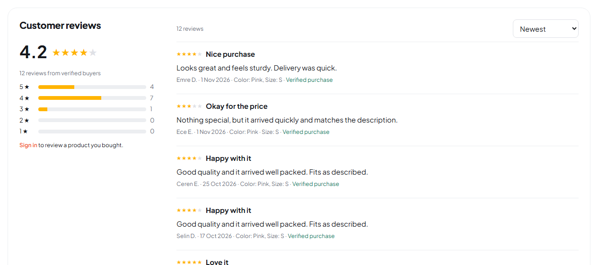 | 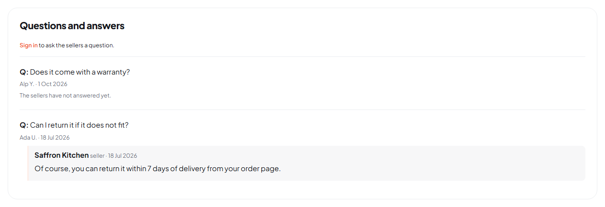 |

- **Only buyers review:** a customer can review a product once one of their packages with it was delivered; one review per customer and product, editable later. Each review shows the variant bought and "Verified purchase", and the author as first name and initial.
- **Ratings everywhere:** the average and count are indexed in OpenSearch (refreshed through the outbox when a review is written or hidden), shown on product cards and as a "Top rated" sort, and the product page carries `aggregateRating` in its structured data.
- **Questions:** any signed-in shopper asks; every seller with an offer on the product is emailed and answers in the seller center (one answer per seller, under the store name). The shopper is emailed the answer.
- **Moderation:** staff hide or show reviews and questions in the back office; a hidden review drops out of the average at once.
- **Measured in ReapDeep:** the storefront sends `review_submitted` (with the rating) and `question_asked`.

### Password reset and email verification

- **Forgot password:** customers reset from the storefront, sellers from the back office sign-in page; staff accounts are not reset by email. The answer is the same whether or not the address has an account, the requests are rate-limited per client and at most three links per account and hour are sent.
- **Tokens never stored in clear:** the API only queues a job; the worker creates the 256-bit token when it sends the email and stores its SHA-256 hash, so neither the users table, the outbox nor a database backup holds a usable link. A new link replaces the previous one; reset links work once, for 30 minutes.
- **After a reset** every session of the account ends at once (including cached copies in Redis), the address counts as verified, and the customer gets a "your password was changed" email that links to a new reset in case it was not them. Changing the password while signed in sends the same notice. Suspended accounts get no link, and a link issued before a suspension stops working.
- **Email verification:** the welcome email carries a confirmation link (valid for 3 days). Unverified customers can shop as usual; the account page asks them to confirm and can send a new link. Coupon campaigns only reach verified, active customers, and the audience preview says how many are left out.
- **Staff help:** on a customer's page staff can email a reset link; they never see or set a customer's password.

### Customers

Staff find customers by name or email and sort them by newest, money spent, number of orders or last order. A customer's page brings together their orders, returns, coupons and reviews from ReapSeek and their behaviour from ReapDeep: the RFM segment with recency, frequency and net revenue, and the latest events (views, searches, carts, purchases) with product names. ReapDeep is asked through its public Query API with the read key; if it is down the rest of the page still loads.

Suspending an account needs a reason, deletes every session of the customer in the same transaction (and their cached copies in Redis), and blocks storefront sign-in with a clear message; orders already placed carry on. Reinstating it lets the customer sign in again.

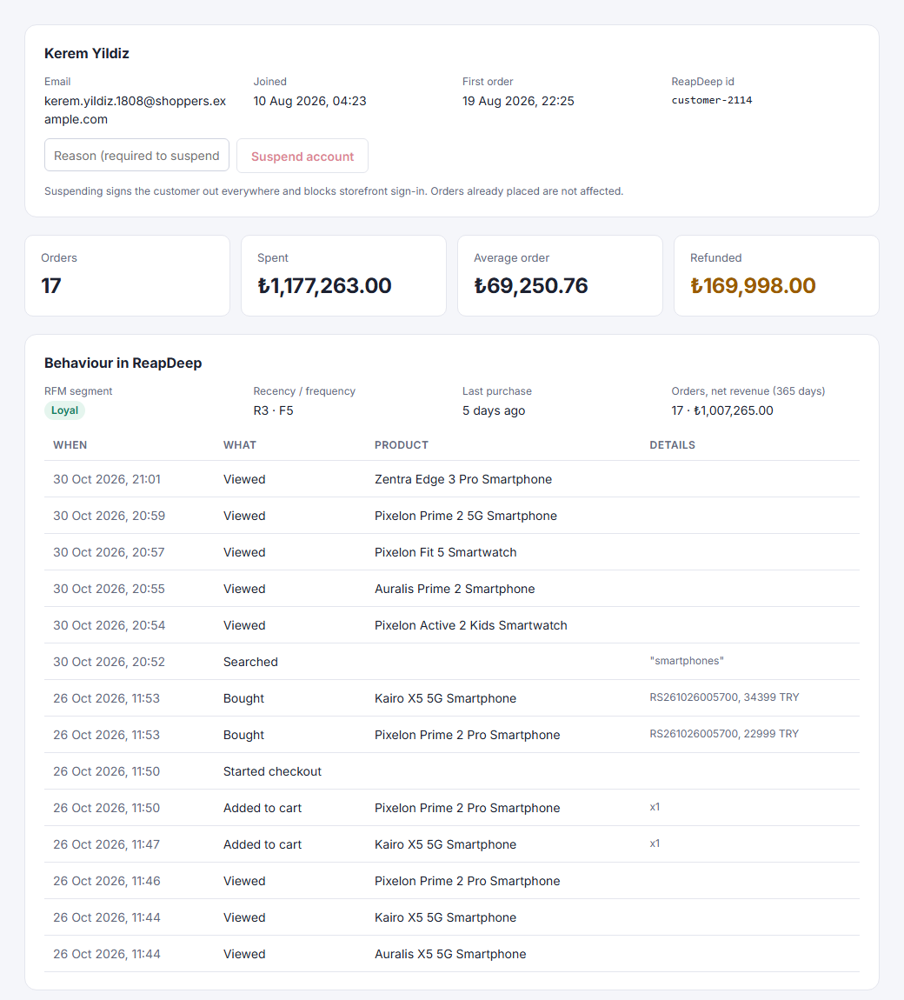

### Campaigns targeted with ReapDeep

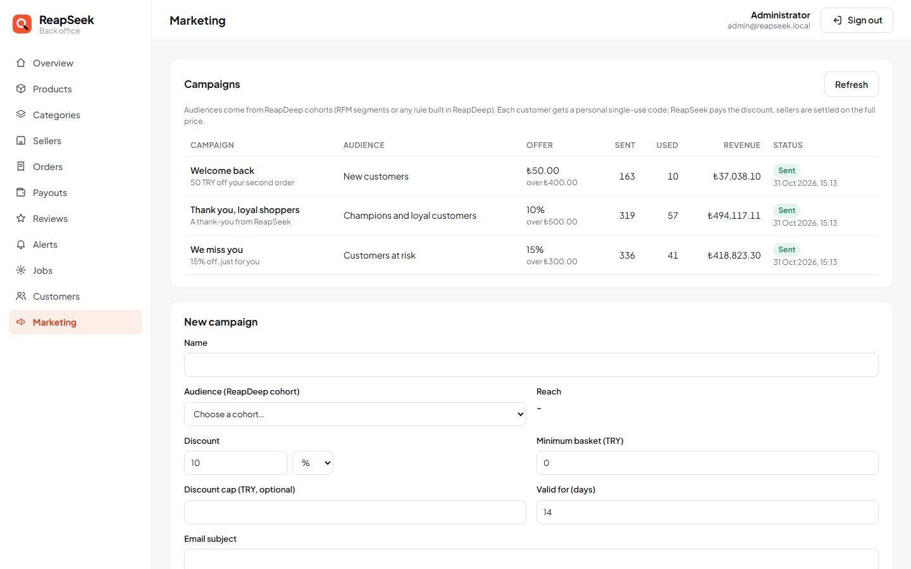

- **Audiences come from ReapDeep:** staff pick a ReapDeep cohort, which can be an RFM segment ("Customers at risk", "Champions and loyal customers", created by `connect-reapdeep.ps1`) or any rule built in ReapDeep. ReapSeek reads the members through ReapDeep's public cohort API with a read key, keeps the `customer-{id}` identities and drops anonymous visitors; the form shows the reach before anything is sent.
- **Personal, single-use codes:** sending issues one code per customer (`RS-XXXXXXXX`, unique per campaign and customer) in one transaction and queues one email per code through the outbox, so a retry never mails twice.
- **At checkout:** the code is checked against its owner, expiry and minimum basket, the discount is reserved with the order in the same transaction, and a failed or expired payment gives it back. Customers can pick their codes with one click. ReapSeek pays the discount: sellers are settled on the full price, and a return refunds only what was paid for the item.
- **Measured:** each campaign shows paid orders and revenue, and the `purchase` events carry the `coupon`, so conversion can be analysed per cohort in ReapDeep.

### Abandoned carts and ReapDeep alerts

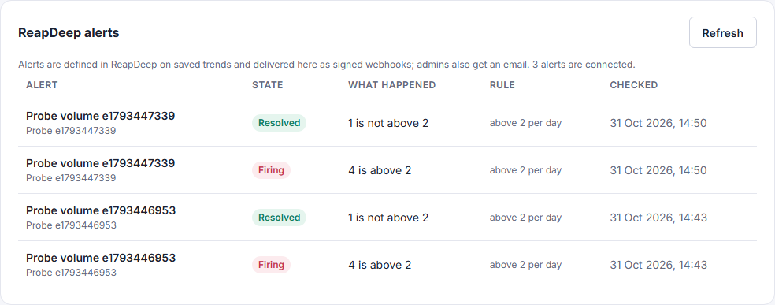

- **One reminder per idle cart:** the worker looks for signed-in customers whose cart has not changed for an hour (20 seconds locally) and sends one email with the items at today's price. Changing the cart starts a new idle period; an empty cart, a guest cart or a cart older than a week gets nothing. The reminder is marked in the same transaction that queues it, so it never goes out twice, and ReapDeep gets a `cart_reminder_sent` event to measure recovery.
- **Alerts from ReapDeep:** alerts are defined in ReapDeep on saved trends (`connect-reapdeep.ps1` creates "Purchases dropped", a 50% fall per day, and "Refunds spiked", more than five refunds a day). ReapDeep posts each change to `POST /api/v1/reapdeep/alerts`, signed with the alert's own secret (`X-ReapDeep-Signature: sha256=...`). ReapSeek keeps one secret per alert, rejects unknown alerts and changed bodies, records each state change once, lists them on the back office Alerts page and emails the admins.

### Favorites, recently viewed and seller stores

| Favorites | Seller store |
|---|---|
| 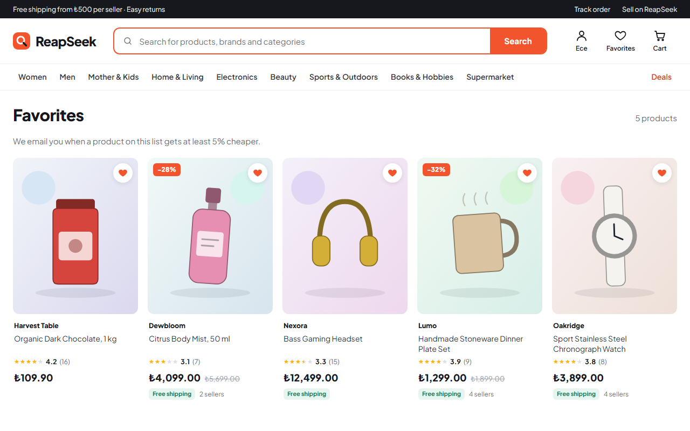 | 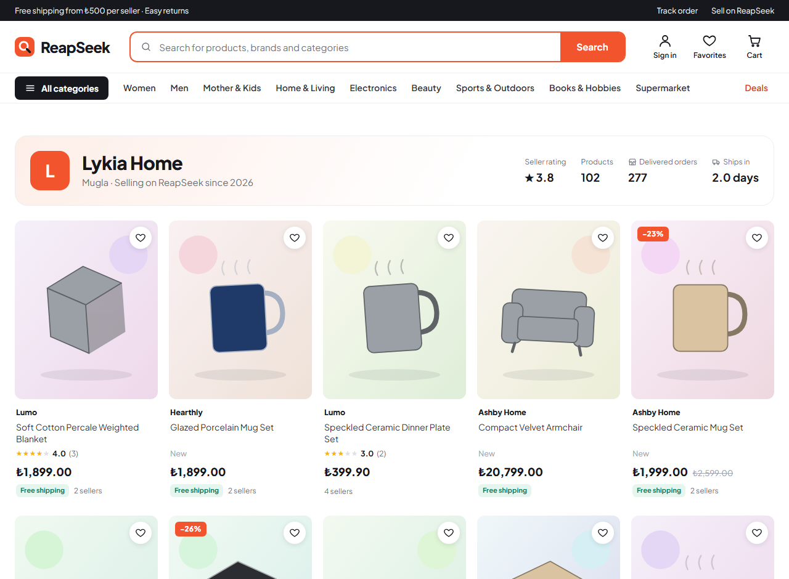 |

- **Favorites:** a heart on every product card and product page saves the product (`/api/v1/wishlist`) and sends `wishlist_added` / `wishlist_removed` to ReapDeep. The price at the moment of saving is stored with the item.
- **Price drop emails:** a worker job compares saved prices with the live buy box price and, when a product gets at least 5% cheaper, emails the customer and records `price_drop_notified` in ReapDeep. The new price becomes the reference, so a customer is told about each further drop once.
- **Recently viewed:** kept in the browser (no server state, nothing personal stored), shown on the home and product pages with live prices from `/api/v1/catalog/cards`.
- **Seller stores:** `/s/{seller}` lists a seller's in-stock products with their rating, delivered orders and average handling time; seller names on product pages link there.

### Recommendations from ReapDeep

ReapSeek shows recommendations computed by ReapDeep from the shoppers' own behavior, the same way any ReapDeep customer would: through the Recommender's public API.

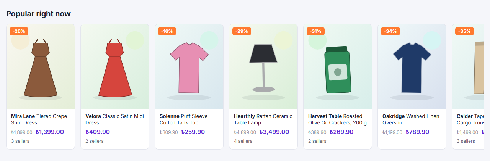

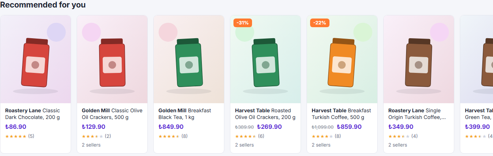

| Shelf | Page | ReapDeep model | When ReapDeep has too few items |
|---|---|---|---|
| Recommended for you | home, signed-in shoppers | `for_you` (neighbors of what this shopper viewed, carted and bought; purchases left out) | **not filled**: hidden below four personal items, so a new shopper never sees a copy of "Popular right now" |
| Popular right now | home | `popular` (30 days, views, carts and purchases weighted 1/3/5) | filled from the catalog |
| Trending this week | home | `trending` (last 7 days against the 21 before) | filled from the catalog |
| Customers also viewed | product | `co_viewed` (shoppers who viewed this one) | filled with popular products **of the same category** |
| Frequently bought together | product, cart | `bought_together` (products in the same orders) | **not filled**: the shelf is hidden below two real items, a padded "bought together" list would be misleading |

- **Server side, never blocking:** the API asks the Recommender with a one-second timeout and the storefront streams each shelf in with React Suspense, so a slow or missing ReapDeep never delays the product page.
- **Live catalog data:** ReapDeep returns product ids; ReapSeek turns them into cards from its own search index, so prices and stock are always current. Products that went out of stock or were archived after ReapDeep trained are dropped.
- **Cache and outage:** the id list is cached in Redis. When ReapDeep is down the last list is served (`served_from: stale`); with no list at all the shelf falls back to the catalog (`served_from: none`). The test suite stops the Recommender and checks both.
- **Personal lists are signed:** ReapDeep only answers `for_you` for a request signed with the project's recommendation secret (`HMAC-SHA256(secret, "customer-{id}.{expires}")`, valid for five minutes). The API signs it for the signed-in shopper, so the secret never reaches the browser and nobody can ask for another shopper's list. Guests get no personal shelf.
- **Cart:** the cart combines the bought-together lists of up to three of its products with reciprocal rank fusion (`1 / (60 + rank)`), so lists with different score scales merge fairly and products already in the cart are left out.
- **Measured in ReapDeep:** each shelf sends `recommendations_shown` once with its items and every click sends `recommendation_clicked` with the position and model, so the click-through rate of each shelf is a trend formula in ReapDeep (`clicked / shown`, broken down by `placement`).

### Shopping simulator

`ReapSeek.Simulator` fills ReapSeek and ReapDeep with believable shoppers, so the analytics, recommendations, cohorts and seller pages have something real to show.

- **Backfill:** builds a deterministic world (same seed, same history) of about 2,000 shoppers over 120 days: six personas (champions, loyal, newcomers, at risk, lapsed, browsers) with their own visit rhythm, sessions that stay mostly in one category with a related second one, product quality that drives ratings and returns, and questions answered by sellers. Orders go through the same domain model as the API (placed, paid, shipped, delivered, returned and refunded), with backdated times, seller ledger entries and weekly payouts; every view, search, cart, purchase and refund goes to ReapDeep with its original timestamp. A default run writes about 6,000 orders, 2,900 reviews, 350 returns and 100,000 ReapDeep events, which gives ReapDeep's RFM segments, cohorts and recommendation models real data.
- **Live mode:** a few concurrent shoppers use the public API like the storefront does: browse categories, search, view products, add to cart, check out with a personal coupon when they have one, pay on the Sandbox page with 3-D Secure (some cards are declined on purpose), then review or return delivered items. Simulated sellers sign in to the seller center to ship packages and decide on returns. It runs until stopped and prints counters every 30 seconds.
- **Fictional data only:** shoppers use `@shoppers.example.com`, sellers `seller-{id}@sellers.example.com`, the phone number is `0100 000 00 00` (no such Turkish number exists), and ReapDeep only sees `customer-{id}`.

```powershell
cd deploy/local
docker compose --profile simulator run --rm simulator backfill   # --customers 2000 --days 120 --seed 42
docker compose --profile simulator up -d simulator              # live mode
```

The backfill runs once per database (it refuses when simulated shoppers already exist). It also registers the simulated card payments and refunds with the payment sandbox, so a shopper can later return a backfilled order and get a real refund; `simulator sync-sandbox` repeats that step on its own. Shopper and seller passwords for the demo are `shopper-pass-1` and `seller-pass-1`.

### Behavioral analytics with ReapDeep

The storefront uses the ReapDeep JS SDK (vendored as `storefront/vendor/reapdeep-js-0.1.0.tgz`, packed from the ReapDeep repository) and sends events straight from the browser to ReapDeep's ingestion API.

| Event | When | Main properties |
|---|---|---|
| `$pageview` | every page, including client-side navigation | URL and referrer (SDK) |
| `search_performed` | a search results page is shown | `query`, `results`, `category`, `brands`, `colors`, `sizes`, `sort`, `page` |
| `search_result_clicked` | a result card is clicked | `query`, `item_id`, `position`, `price` |
| `search_suggestion_clicked` | a suggestion is picked | `query`, `type`, `value` |
| `product_viewed` | a product page is opened | `item_id`, `price`, `category`, `department`, `brand`, `seller_id`, `in_stock` |
| `add_to_cart` | an item is added from the product page | `item_id`, `offer_id`, `seller_id`, `price`, `quantity` |
| `checkout_started` | the checkout page is opened | `value`, `items`, `sellers` |
| `recommendations_shown` | a recommendation shelf is shown | `placement`, `model`, `source_item_id`, `item_ids`, `count`, `served_from` |
| `recommendation_clicked` | a recommended product is clicked | `placement`, `model`, `source_item_id`, `item_id`, `position`, `source`, `price` |
| `review_submitted` | a review is posted or edited | `item_id`, `rating`, `edited` |
| `question_asked` | a question is asked | `item_id` |
| `refund` (server) | a return is refunded | `item_id`, `order_id`, `return_id`, `price`, `quantity`, `amount`, `currency`, `seller_id`, `sku` |
| `purchase` | sent by the worker when an order is paid, one per order line | `item_id`, `order_id`, `price`, `quantity`, `amount`, `seller_id`, `coupon` |
| `cart_reminder_sent` (server) | an abandoned-cart email is sent | `quantity`, `amount` |
| `coupon_applied` | a code is applied at checkout | `code`, `discount` |

`item_id` is the ReapSeek product id, the same key the catalog sync uses, so ReapDeep can join behavior with the catalog for recommendations. Purchases are sent from the server rather than the browser, so they are counted even when the customer closes the tab after paying; each line has a stable `event_id`, so a retry never counts twice.

- **Identity:** when a customer signs in, the storefront calls `identify("customer-{id}")`; ReapDeep links the anonymous browsing history to the customer. Signing out calls `reset()`, so the next visitor on the same browser starts with a new anonymous id. Identity is synchronized before any page event is sent.
- **Configuration:** the public key and the ingestion and recommender URLs come from `deploy/local/.env` (written by `connect-reapdeep.ps1`); without them the storefront runs without tracking.

### ReapDeep catalog sync

Every change that affects what shoppers see (a product edit, a status change, an offer, a seller suspension) writes a `products_changed` message to the outbox in the same transaction. The worker batches these messages and sends the affected products to ReapDeep's catalog API with a `catalog_write` key: active products are upserted with their buy box price, stock status, storefront URL and image; drafts and archived products are removed. A full sync runs after seeding and after connecting.

`deploy/local/connect-reapdeep.ps1` connects a running ReapSeek stack to a running ReapDeep stack the way any customer would: it signs in to ReapDeep, creates a `ReapSeek` project through ReapDeep's API, creates the API keys and the recommendation secret and writes them to `deploy/local/.env`.

## Repository layout

```
src/
  ReapSeek.Api/        Minimal API (feature folders: Identity, Catalog, Search, Carts, Checkout, Orders, Payments, ...)
  ReapSeek.Domain/     Domain model for carts, orders and money, no dependencies
  ReapSeek.Worker/     Outbox processor, emails, search indexing, ReapDeep sync and purchase events, payment expiry
  ReapSeek.Shared/     Migrations, outbox contracts, order persistence, Redis cache, validation helpers
  ReapSeek.Sandbox/    Simulated payment provider, carrier and bank transfers
  ReapSeek.Simulator/  Shopping simulator: history backfill and live shoppers
storefront/            Next.js storefront
backoffice/            React back office
deploy/local/          Docker Compose stack and end-to-end tests
tests/                 Unit tests
```

## Running locally

Requirements: Docker Desktop, PowerShell (Windows) and, for development outside Docker, the .NET 10 SDK and Node.js 22+.

```powershell
cd deploy/local
.\run-local.ps1
```

The script creates `deploy/local/.env` with random passwords on the first run, builds the images, starts the stack and seeds the demo catalog (skipped when the catalog already has data; `docker compose run --rm migrate --seed --reset` replaces it).

To feed ReapDeep, start the [ReapDeep](https://github.com/guvenimat/ReapDeep) stack as well and run:

```powershell
.\connect-reapdeep.ps1
```

| Service | URL |
|---|---|
| Storefront | http://localhost:3100 |
| Back office | http://localhost:3101 (admin credentials are in `deploy/local/.env`) |
| API | http://localhost:8100 |
| Payment sandbox | http://localhost:8101 |
| Mailpit | http://localhost:8025 |
| Grafana (traces, metrics, logs) | http://localhost:3102 |
| OpenSearch | http://localhost:9200 |
| Redis | localhost:6380 (password in `deploy/local/.env`) |

## Running on Kubernetes

The same stack runs on a local Kubernetes cluster (k3d), deployed by Argo CD from this repository:

```powershell
cd deploy/k8s
.\up.ps1              # cluster, images, secrets, Kyverno, Argo CD; Argo CD then syncs deploy/k8s/chart/reapseek from main
.\up.ps1 -Local       # or install the chart from the working tree with Helm, without Argo CD
```

| Piece | What it does |
|---|---|
| `deploy/k8s/chart/reapseek` | Helm chart: API, worker, sandbox, storefront, back office, optional live simulator, PostgreSQL, Redis, OpenSearch, Mailpit and Grafana LGTM |
| Probes | The API has `/livez` (liveness) and `/healthz` (readiness: database and search); the worker's liveness is its outbox heartbeat (`ReapSeek.Worker health heartbeat`) |
| Autoscaling | The API runs 4 to 8 replicas with an HPA on CPU; a Kyverno policy (`deploy/k8s/policies`) rejects any HPA above 16 replicas in the namespace |
| Limits | Every container has requests and limits; a ResourceQuota and LimitRange bound the namespace |
| Ordering | Argo CD sync waves: data stores, then the migration Job (a sync hook), then the API, worker and autoscaler, then the web apps; the simulator backfill is a hook that skips when data exists |
| Secrets | Created from `deploy/local/.env` by `up.ps1`, never committed. ReapDeep keys are left out unless `-ConnectReapDeep` is given, so a fresh cluster does not mix its customer ids into the ReapDeep project used by Docker Compose |

| Service | URL |
|---|---|
| Storefront | http://shop.localhost:8080 |
| Back office | http://office.localhost:8080 |
| Payment sandbox | http://sandbox.localhost:8080 |
| Grafana | http://grafana.localhost:8080 |
| Mailpit | http://mail.localhost:8080 |

On a 16 GB machine run either Docker Compose or the cluster, not both.

## Tests

```powershell
dotnet test tests/ReapSeek.UnitTests
cd deploy/local
.\auth-test.ps1
.\catalog-test.ps1
.\search-test.ps1
.\product-test.ps1
.\checkout-test.ps1
.\scale-test.ps1
.\recommendations-test.ps1
.\seller-test.ps1
.\returns-test.ps1
.\reviews-test.ps1
.\campaigns-test.ps1
.\engagement-test.ps1
.\jobs-test.ps1
.\images-test.ps1
.\customers-test.ps1
.\account-test.ps1
```

The scripts run end to end against the running stack.

- `auth-test.ps1`: registration, sign-in, session separation, password change, the welcome email arriving in Mailpit through the outbox, server-rendered storefront pages and the sign-in rate limit.
- `catalog-test.ps1`: access rules, the seeded catalog, category, brand and seller rules, the variant matrix, the buy box under price, stock, pause and suspension changes, search and filters, the sync to ReapDeep (publish, price change, seller suspension, archive) and the image endpoints.
- `search-test.ps1`: index consistency, typos, synonyms, accents and mixed-field queries, facet counts, sorting and paging, suggestions, the index following catalog changes, a zero-downtime rebuild and the server-rendered storefront pages.
- `product-test.ps1`: the storefront product API (hidden offers, buy box, low stock), the server-rendered product page and its structured data, the sitemap, and a real headless Chrome session (`tools/browse.mjs`) that searches, clicks a result, signs in and out, then checks in ReapDeep that every event arrived and that the anonymous visitor and the customer became one person.
- `recommendations-test.ps1`: sends controlled views and orders to ReapDeep, waits for it to retrain, then checks every shelf: ranking, the same-category fill, bought-together without padding, live prices and stock on cached lists, cart merging, the personal list (ranking, no purchased products, hidden when short, nothing for guests), validation, the server-rendered pages, `recommendations_shown` and `recommendation_clicked` from a real browser, and a Recommender outage (stale list, then catalog fallback).
- `scale-test.ps1` (needs the second instance: `docker compose --profile scale up -d`): the sign-in limit shared between two instances, sign-out and password change taking effect on the other instance at once, product page and category tree invalidation across instances, and a Redis outage.
- `seller-test.ps1`: seller logins and role separation, product proposals with approval and rejection, offers and the buy box, a paid order shipped with a Sandbox tracking number and a shipping email, delivery writing the ledger, the 7-day hold, the weekly payout with a Sandbox transfer and its idempotency, and a headless Chrome session that ships a package from the seller center.
- `returns-test.ps1`: carrier tracking to delivery, the return rules (window, quantities, reasons, ownership), seller approval and rejection with emails, the return parcel reaching the seller, the card refund, the ledger and the next payout after a refund, the `refund` event in ReapDeep, a forged and a replayed carrier webhook, and a headless Chrome session where the customer asks for a return and the seller approves it.
- `reviews-test.ps1`: who may review (only after delivery, never guests or non-buyers), validation, one editable review per customer, the average and distribution, sorting, the rating in search and in the product page's structured data, questions and seller answers with both emails, answer rights, moderation that updates the average and search, and a headless Chrome session that edits a review and asks a question on the product page, with the events checked in ReapDeep.
- `campaigns-test.ps1`: a static cohort created in ReapDeep, the audience preview (customers only), campaign validation, sending once with one email and personal code per customer, the code rules (owner, minimum basket, single use, case), checkout with the discounted total and payment, the code coming back after a failed payment, campaign revenue, the `coupon` on ReapDeep purchase events, the refund of a discounted item, and one-click codes at checkout in a headless Chrome session.
- `account-test.ps1`: the confirmation link in the welcome email, only token hashes stored, resending from the account page in a browser, single-use and replaced links, the same answer for unknown addresses, a reset in a real browser that signs out every session, the change notice, expiry, the hourly limit, suspended accounts, a seller reset in the back office, staff accounts kept out, and staff sending a link.
- `customers-test.ps1`: access, search with literal wildcards, sorting by spend checked against the database, paging, the customer page and its ReapDeep segment and activity, suspension ending every session at once and blocking sign-in, reinstatement, and staff accounts kept out.
- `images-test.ps1`: uploads as staff and as a seller, the order of photos and illustrations, the file served by the API and the storefront, the photo reaching the product page and search cards, rejected files (not an image, too small, too large, too many), path tricks, removal with the file, and a seller locked out after approval.
- `jobs-test.ps1`: a job that gives up after ten attempts, the admin email, the Jobs list and summary, retrying and discarding one job, retrying every failed job of a type, and a failure notice that never notifies about itself.
- `engagement-test.ps1`: one abandoned-cart reminder per idle period with the items and prices, none for emptied or guest carts, a new one after a change, the ReapDeep event; a real alert defined and fired in ReapDeep reaching the back office and the admins' inbox, unknown alerts, changed bodies and duplicate deliveries rejected.
- `checkout-test.ps1`: cart rules, prices and stock changes, the guest cart merge, checkout validation, a full payment with 3-D Secure (stock, packages, webhook signature and replay, cart cleanup, confirmation email, back office, `purchase` events in ReapDeep), declined cards, the payment timeout, a payment provider outage, and a headless Chrome session that buys a product from the product page to the confirmation page.

## License

Apache License 2.0. See [LICENSE](LICENSE) and [NOTICE](NOTICE).

The local stack runs third-party images unmodified as separate containers; they are not part of this repository: PostgreSQL (PostgreSQL License), Redis (RSALv2/SSPLv1/AGPLv3), OpenSearch (Apache 2.0), Mailpit (MIT) and `grafana/otel-lgtm` (Apache 2.0, with Grafana, Loki and Tempo under AGPLv3 and Prometheus under Apache 2.0).
